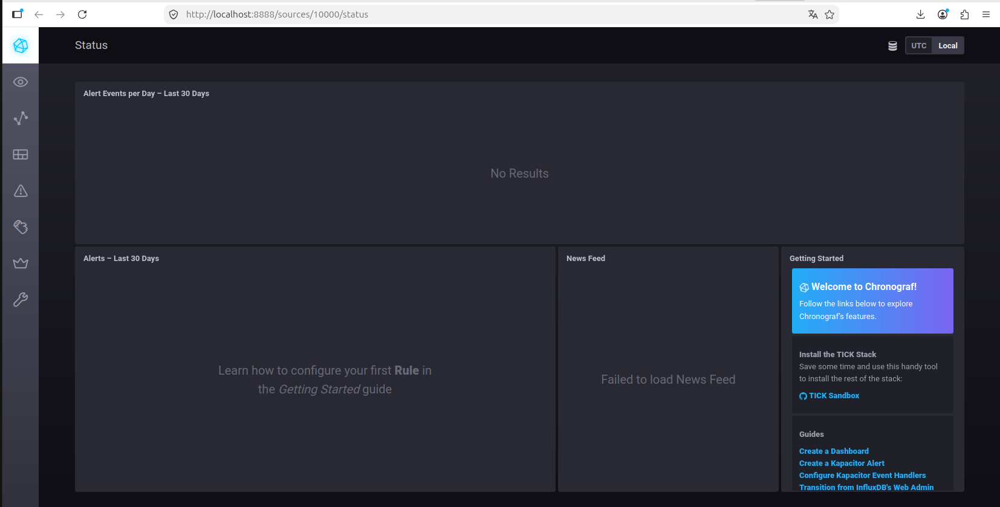
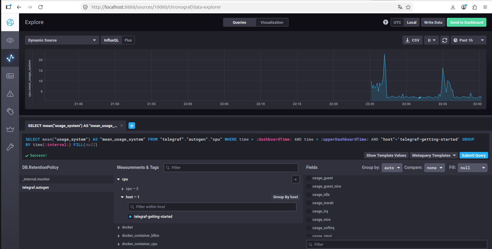
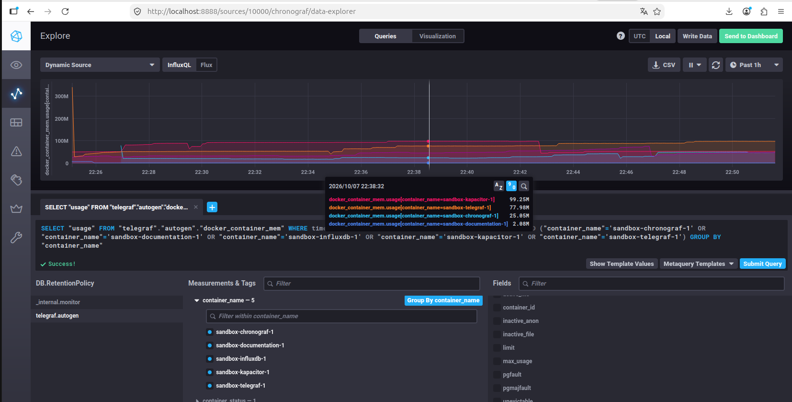

## Исходное задание

Задание доступно по [ссылке](https://github.com/netology-code/mnt-homeworks/blob/MNT-video/10-monitoring-02-systems/README.md) или в [README-TASK.md](README-TASK.md)

## Ответ на задание

### 1

1. Целесообразно настроить мониторинг основных ресурсов хоста(-ов), где функционирует платформа:
	- CPU LA - нагрузка на ЦПУ (платформа занимается вычислениями)
	- RAM\swap - занятость ОЗУ (для мониторинга потребления памяти, поиска потенциальных утечек)
2. Т.к. данные сохраняются на диск, то целесообразно собирать следующие метрики:
	- IOPS 	  - нагрузка при записи\чтении отчетов с диска.
	- inodes  - кол-во занятых ID для inodes, для мониторинга заполненности ФС.
3. Для дальнейшего формирования SLA,в качестве SLI можно взять метрику числа ошибок на стороне сервера (коды 5xx HTTP) к общему числу HTTP запросов.
4. Можно добавить метрики по времени выполнения вычислений и составления отчетов: средние значения и распределение значений (тип histogram в Prometheus)

### 2

Я бы предложил рассмотреть метрику "недоступности платформы". В терминах DevOps:
	- SLI - доля успешных HTTP-запросов (не равных 5хх)
	- SLO - доля успешных запросов к сервису должна составлять не менее 99% за полгода. Процент и срок можно скорректировать отдельно, т.к. эти параметры зависят от нескольких факторов: размер команды (круглосуточная ли поддержка?), внешний или внутренний потребитель, требования от заказчика и др.
	- SLA - детальнее обсудить с заказчиком, основываясь на SLO.

### 3

Затрудняюсь ответить на вопрос. Если платформа не является распределенной, а деплой не происходит внутри кластера K8s, то предположительно есть выделенный сервер, куда разработчикам можно выделить доступ на чтение напрямую из приложения (Docker)

Если же платформа распределенная, то как вариант, который знаю лично я - в Prometheus можно текст ошибки пробросить в label, а дальше в Grafana, например, можно отдельно создать view и выводить тексты ошибок.

### 4

Предполагаю, что ошибка может быть связана с тем, что в формуле не учитываются коды 3хх HTTP. По сути это валидный ответ от сервера, например, в случае с перенаправлением на сервер аутентификации. В таком случае сервер может вернуть клиенту ответ с кодом 302. Или также валидным должен считаться код 304 Not Modified, если данные в браузере закэшированы.
Поэтому я бы добавил в числитель также метрику summ_3xx_requests, тогда итоговая формула вы выглядела так:

(summ_2xx_requests+summ_3xx_requests)/summ_all_requests

### 5
Pull:

Плюсы:
- централизованная настройка, легче администрировать
- можно настроить единый proxy server до всех агентов с TLS
- упрощенная отладка получения данных с агентов, в отличие от push модели

Минусы:
- если на агенте произошло важное событие, он не сообщит серверу об этом автоматически, а будет ждать пока тот его опросит
- чем больше агентов, тем больше соединений создается на сервере
- сложность мониторинга короткоживущих метрик, все упирается в 

Push:

Плюсы:
- один агент может отправлять метрики одновременно нескольким серверам-получателям.
- более гибкая настройка отправки пакетов данных с метриками
- можно вместо TCP использовать UDP, что ускоряет процесс отправки и получения метрик.

Минусы:
- усложненная отладка - для тестирования отправки метрик потребуется вручную подключаться к агенту, либо настроить малый период отправки метрик.
- любой, кто знает адрес сервера, может пушить данные. надо отдельно продумывать вопрос аутентификации агентов.
- при UDP нет гарантии доставки

### 6
- Prometheus - pull
- TICK - push
- Zabbix - гибрид
- VictoriaMetrics - гибрид
- Nagios - pull

### 7

### 8

### 9

