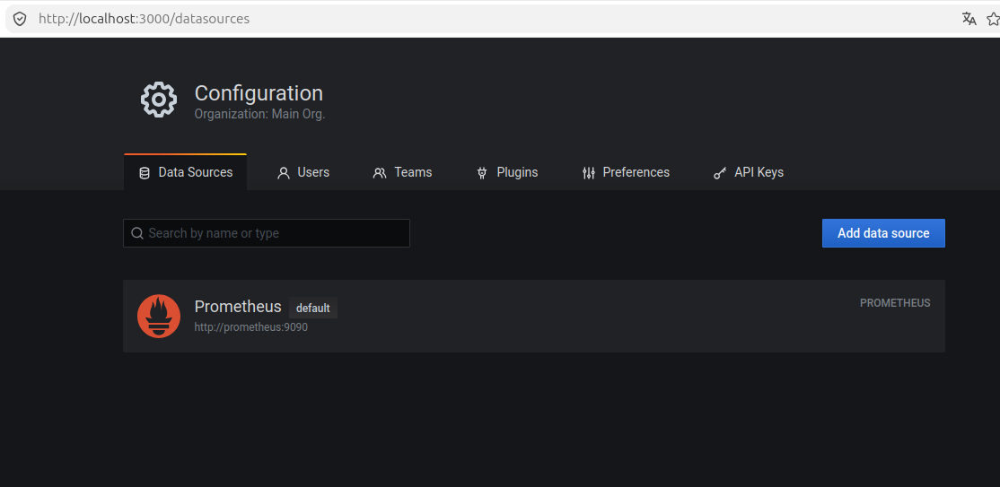
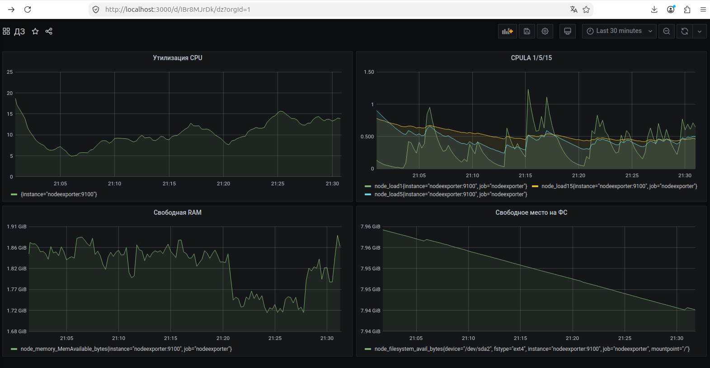
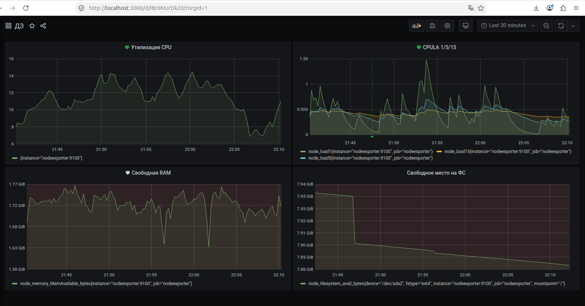

## Исходное задание

Задание доступно по [ссылке](https://github.com/netology-code/mnt-homeworks/blob/MNT-video/10-monitoring-03-grafana/README.md) или в [README-TASK.md](README-TASK.md)

## Ответ на задание

### Задание 1



### Задание 2

- утилизация CPU для nodeexporter (в процентах, 100-idle):
```
100 - (avg by (instance) (rate(node_cpu_seconds_total{mode="idle"}[5m])) * 100)
```
- CPULA 1/5/15:
```
{__name__=~"node_load1|node_load5|node_load15"}
```
- количество свободной оперативной памяти:
```
node_memory_MemAvailable_bytes
```
- количество места на файловой системе:
```
node_filesystem_avail_bytes{mountpoint="/"}
```



### Задание 3



### Задание 4

Созданный дашборд был экспортирован в [файл](dashboard.json).