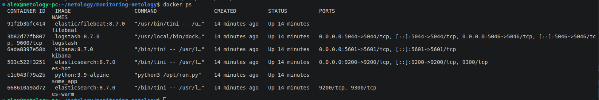
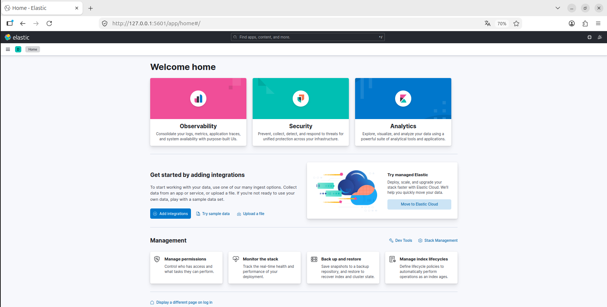
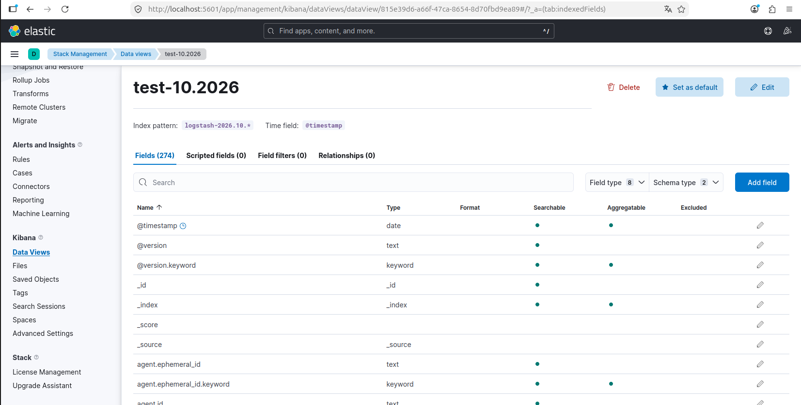
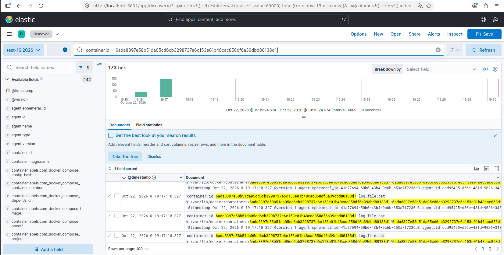

## Исходное задание

Задание доступно по [ссылке](https://github.com/netology-code/mnt-homeworks/blob/MNT-video/10-monitoring-04-elk/README.md) или в [README-TASK.md](README-TASK.md)

## Ответ на задание

### Задание 1

### Задание 2

Во вкладке `Stack Management -> Data views` были созданы 2 view для index patterns:
- `logstash-2026.10.*` - данные за октябрь 2026
- `logstash*` - все данные

Пример index pattern:

Пример поиска по логам с фильтрацией по conteiner.id:

